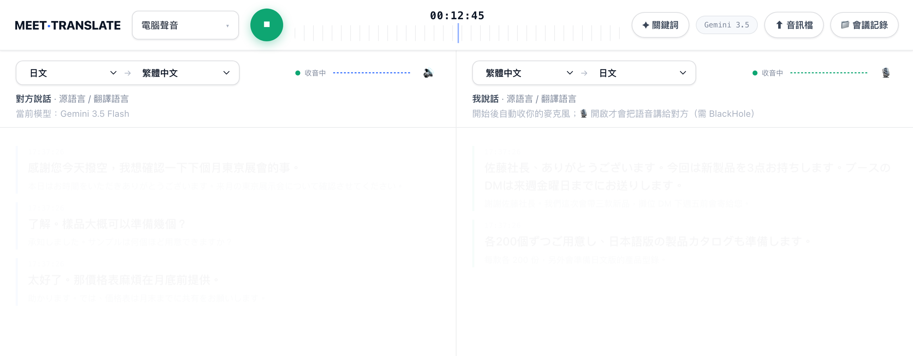
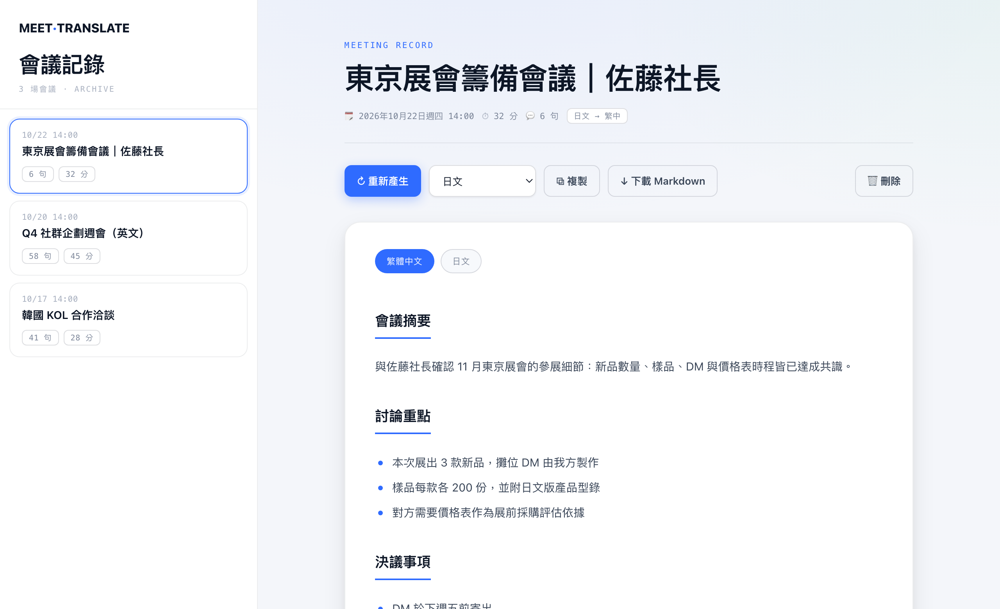
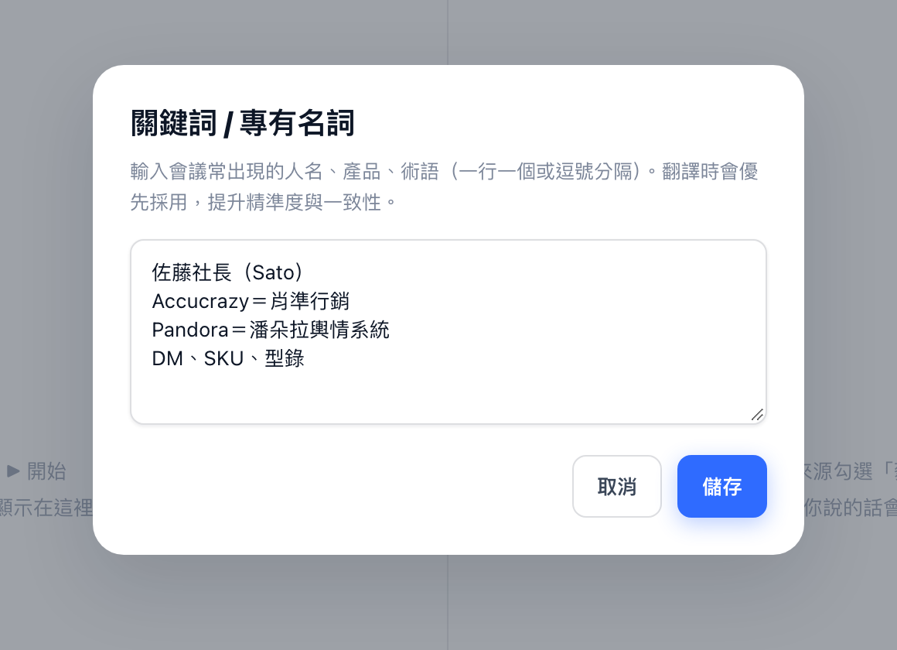

# MeetTranslate｜跨語會議即時翻譯 × AI 雙語會議記錄

> 騰雲集團 2026 AI 應用競賽 · 作品 01
> Google Meet／Zoom 網頁版會議的即時雙向翻譯 Chrome 擴充功能（v3.5.1），會後一鍵產生雙語會議記錄。辨識、翻譯、語音合成、會議記錄全部使用 Google Gemini，只需要一把 API Key。

## 要解決的問題

- 和日韓、海外客戶的線上會議越來越多，聽不懂就要等外語同事陪同，或會後反覆聽錄音。
- 會議記錄靠人工整理，一場會議要再花 1–2 小時，數字與交期最容易漏。
- 寄給客戶確認的記錄還得再翻一次。

## AI 如何介入流程

1. **擷取聲音**：會議分頁音訊＋我的麥克風，分成「對方」與「我」兩路。
2. **自動斷句**：偵測說話與停頓，一句講完就送出。
3. **辨識＋翻譯（Gemini）**：套用使用者的關鍵詞表（客戶名、品牌、縮寫）。
4. **字幕＋語音（Gemini）**：雙欄即時字幕；需要時合成語音，透過虛擬麥克風講給對方。
5. **雙語會議記錄（Gemini）**：會後整理摘要、討論重點、決議、待辦，中文與對方語言兩版。

| 會議記錄 | 關鍵詞 |
|---|---|
|  |  |

截圖使用示範資料。

---
## 一、安裝（只做一次）

1. `git clone` 此 repo（或下載 zip 解壓縮）。
2. Chrome 網址列輸入 `chrome://extensions`。
3. 打開右上角「開發人員模式」。
4. 點「載入未封裝項目」，選擇 repo 裡的 `extension` 資料夾。
5. 點工具列的拼圖圖示，把 MeetTranslate 釘選出來。

## 二、設定 API Key（只做一次）

1. 到 https://aistudio.google.com/apikey 登入 Google 帳號，建立一把金鑰（`AIza` 開頭）。
2. 點 MeetTranslate 圖示 →「API」分頁 → 貼上金鑰 →「儲存 API Key」。

金鑰只存在你自己的瀏覽器。用量超過 Gemini 免費額度才會計費。

## 三、選語言

點圖示 →「語言」分頁：

| 欄位 | 怎麼選 |
|---|---|
| 對方語言 | 客戶說的語言；不確定就選「自動偵測」 |
| 對方 → 我看 | 字幕要翻成什麼，通常是繁體中文 |
| 我說的語言 | 我開口說的語言，通常是繁體中文 |
| 字幕顯示原文 | 開著時，譯文下方會附原句 |

翻譯介面左右兩欄上方也能直接改語言。

## 四、開始翻譯（每場會議）

1. 先進入 Google Meet／Zoom 網頁版會議。
2. 點圖示 →「開啟即時翻譯介面」。
3. 「聲音來源」勾「電腦聲音」；要翻譯自己的話再勾「麥克風」。
4. 按綠色 ▶，在分享視窗選「Chrome 分頁」裡的會議分頁。
5. **務必打開「一併分享分頁音訊」**，按分享。
6. 音波開始跳動代表有收到聲音，字幕隨即出現。再按一次 ⏹ 停止。

畫面說明：左欄是對方說的話（大字譯文、小字原文），右欄是我說的話。

另一個入口：彈窗裡的「在此會議分頁快速開始（字幕浮層）」，會直接在會議分頁上疊一層字幕。

## 五、進階功能

### 關鍵詞
翻譯介面右上角「✦ 關鍵詞」，一行一個客戶名、公司名、產品、縮寫，可用「＝」指定譯法（例如 `Accucrazy＝肖準行銷`）。辨識、翻譯、音訊檔都會優先套用。

### 雙向語音（AI 用對方語言替我開口，Mac）
1. 安裝 BlackHole 2ch（https://existential.audio/blackhole/ 或 `brew install blackhole-2ch`），裝完重開 Chrome。
2. 彈窗「雙向語音」分頁：啟用雙向語音；「我的麥克風」選真的麥克風；「語音送往」選 BlackHole 2ch。
3. Meet：設定 › 音訊 › 麥克風選 BlackHole 2ch。
4. 開會時聲音來源加勾「麥克風」，右欄打開 🎙。
5. **務必戴耳機**，避免回音。

### 音訊檔翻譯
翻譯介面「⬆ 音訊檔」，選錄音或錄影檔。Gemini 會整段轉錄並翻譯，完成後自動存進會議記錄。即時翻譯進行中無法匯入；很長的檔案可能失敗，建議分段上傳。

### 雙語會議記錄
1. 停止翻譯後，點「📁 會議記錄」，選這場會議。
2. 按「✦ 產生雙語會議記錄」，選第二語言。
3. 內容包含摘要、討論重點、決議事項、待辦事項，中文與對方語言兩版切換；可改標題、複製、下載 Markdown。

## 六、資料治理與限制

- 逐字稿與會議記錄只存在本機瀏覽器（`chrome.storage.local`），不經過自建伺服器。
- 會議語音片段會送到 Google Gemini API 做辨識與翻譯；機密會議請先確認符合集團資料治理規範。
- 支援 Chrome 上的 Google Meet、Zoom 網頁版；Zoom 桌面 App 不支援。
- 非串流方案：一句話講完約 1.5–3 秒出現譯文（依網路與句長）。

## 七、疑難排解

| 狀況 | 解法 |
|---|---|
| 按 ▶ 後沒有字幕 | 分享視窗要選「Chrome 分頁」並打開「一併分享分頁音訊」 |
| 提示「請先設定金鑰」 | 彈窗 API 分頁貼上 Gemini API Key 並儲存 |
| 人名、品牌翻錯 | 加進「✦ 關鍵詞」 |
| 對方聽不到 AI 語音 | Meet 麥克風選 BlackHole 2ch，右欄 🎙 要打開 |
| 出現回音或循環 | 戴耳機 |
| 自己聽不到對方聲音 | 系統輸出不要只剩 BlackHole，改回耳機或喇叭 |
